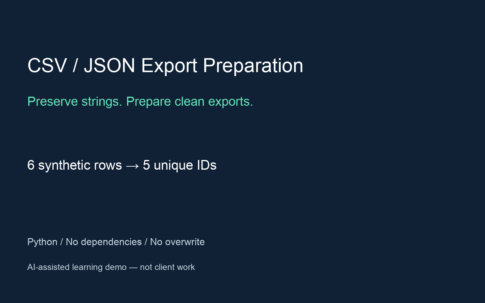

# CSV ↔ flat JSON — learning demo


An original learning demonstration for a future Python CSV/JSON service portfolio. Synthetic data, not a client case study. One CLI script using only Python's standard library. No dependencies, APIs, network, or accounts. Verified on Python 3.12; other versions have not been separately tested.

Run from the project directory, choosing unused output filenames:

```sh
python3 converter.py csv-to-json examples/input.csv result.json --trim --rename product=name --dedupe-key id
python3 converter.py json-to-csv result.json result.csv
python3 -m unittest discover -v
```
 `examples/expected.json` and `examples/expected.csv` are ready-made results. With `--trim`, six source rows become five unique IDs. IDs (including `id001` and `0002`), Cyrillic, `Écrou`, an empty product name, and leading-zero quantities remain strings.

Rules, in both directions:

1. Defaults preserve whitespace and duplicates.
2. `--trim` applies Python `str.strip()` to every value, removing surrounding Unicode whitespace only. Headers are not trimmed; surrounding whitespace in a header is invalid.
3. Repeat `--rename OLD=NEW` for distinct input columns. Renames are simultaneous. Unknown or repeated source names, empty names, and output collisions are errors.
4. `--dedupe-key KEY` refers to the renamed column and to the trimmed value only when `--trim` is enabled; otherwise whitespace is retained. First occurrence wins; input order is retained. Comparison is case-sensitive with no Unicode normalization. Blank keys are errors; empty product names are allowed.
5. All values remain strings. Column order follows the CSV header or first JSON object. JSON uses two-space indentation and literal Unicode. CSV uses LF and standard quoted-field escaping.

Limits: input and output at most 1 MiB, UTF-8 without BOM, nonempty data, unique nonblank headers with no surrounding whitespace. CSV uses commas and double quotes with doubled quote escaping; CRLF and quoted newlines are supported. Records must match header width; blank lines are errors. Parsing uses `csv.reader(strict=True)`, not a universal CSV-dialect validator. JSON must be a nonempty array of flat objects with identical key sets and string values. Duplicate members, numeric/null values, and nesting are rejected. Empty tables are unsupported because an empty JSON array carries no schema. Everything is held in memory; no throughput or large-data performance claim is made. The CSV field limit is explicitly set to 1 MiB characters; the total byte limit still applies. If formatting expands the output beyond 1 MiB, conversion fails before writing.

Exit 0 means success; input/output/argument errors return 2 with `error:` on stderr. Validation finishes before creating the output. The result becomes visible only after the temporary file is completely written, flushed, fsynced, and successfully closed. Atomic hard-link creation refuses an occupied destination, including a competing writer, ordinary or dangling symbolic links, and the source itself. Nothing is overwritten. Round trips preserve transformed data, not the original CSV formatting. CSV values are not sanitized for spreadsheet formulas; treat untrusted CSV as text.

`evidence/current-tests.txt` records the full local test run; `evidence/review-final.md` records the review. Tests use temporary directories and can be rerun without deleting the example outputs.

### Failure model and publication

Verified environment: Python 3.12.3 on macOS, a local filesystem supporting atomic no-clobber hard links. A `.csv-json-*.tmp` file is created in the destination directory with private permissions (normally 0600); the result retains those permissions. Unsupported hard links cause an error; there is no fallback that overwrites files.

Before commit, creation, write (including short-write), flush, fsync, close, or link failures return 2. No new destination is published; the temporary file is removed if cleanup is available. Success returns 0 only after publication and removal of the temporary name.

If cleanup itself fails, exit 2 and the error identify the temporary path and publication state. After a successful commit, the complete destination remains even if cleanup fails; the program does not delete it or report success. Inspect the named files before retrying. In that case the temporary name and destination refer to the same file: remove only the temporary name during cleanup; do not edit its contents. Another writer's destination is never deleted.

The contract assumes trusted, stable parent directories and an input that nobody changes during reading. Stable parent-directory symlinks and an input symlink are supported. Hostile directory/temporary-file replacement, network filesystems, ambiguous syscall outcomes, SIGKILL, OS crashes, hardware failures, and power loss are outside the model. File fsync does not guarantee directory-entry durability after power loss. Abrupt termination can leave a temporary file. Absolute error freedom and power-loss durability are not claimed.

Tests inject failures at filesystem-operation boundaries; they do not physically fill a disk or cut power. Two actual competing processes are also tested. The current full run is `evidence/current-tests.txt`.

## Portfolio disclosure

AI-assisted learning demo with synthetic data. Not a client engagement. The converter implementation and tests are preserved from the original local learning demo. Current verification is in evidence/current-tests.txt.

## Repository status

Public learning portfolio project with synthetic fixtures. AI-assisted development. No private client data, live credentials or production state are included. No client outcomes or revenue claims. Tests are local checks, not proof of live service integration.
